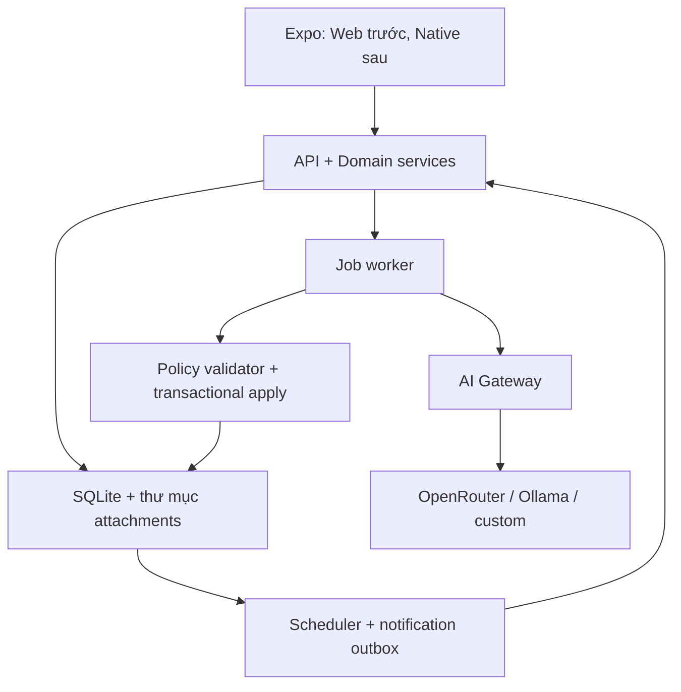

# 02 — Kiến trúc đề xuất

## 1. Topology



Một process API chứa worker và scheduler ở MVP 1/2. HTTP API không giữ request mở chờ OCR; trả 202 và poll job hoặc subscribe SSE qua web adapter. Polling là đường mặc định tương thích native; SSE là tùy chọn. Không giữ việc cần làm chỉ trong setTimeout/setInterval; timer chỉ đánh thức truy vấn database.

## 2. Monorepo

```text
apps/client/              Expo + Expo Router
apps/server/src/api/      auth, routes, validators
apps/server/src/domain/   task, project, memo, recurrence, people
apps/server/src/ai/       adapters, prompts, schema validation
apps/server/src/jobs/     leases, retries, worker
apps/server/src/scheduler/ occurrence, outbox, recovery
apps/server/src/storage/  attachment store, backup
packages/contracts/      Zod schemas, DTO, error enums
packages/api-client/     typed client, không chứa key provider
packages/ui/             RN components + theme
packages/platform/       .web/.native adapters
migrations/              SQL có phiên bản
scripts/                 start-local.ps1, stop-local.ps1, backup, restore
infra/                   Dockerfile, compose, proxy example
```

Không yêu cầu tạo mọi package rỗng nếu chưa dùng; ranh giới phụ thuộc phải giữ. API/domain không import UI. Contracts không import server secrets hoặc SQLite driver.

## 3. Pipeline xử lý

1. Transaction lưu memo revision, file metadata và processing job sau khi file đã staging an toàn.
2. Worker claim lease bằng cập nhật có điều kiện trong transaction; không giữ transaction khi gọi LLM.
3. Ảnh → OCR role → lưu OCR run và text theo ảnh.
4. Information role nhận nguồn + now/captured_at/timezone + taxonomy + candidate entities được giới hạn.
5. Parse proposal → validate schema → resolve references → check policy, ambiguity, duplication và current versions.
6. Transaction apply những action hợp lệ, tạo source links/audit/reminders và action result cùng lúc.
7. Các phần chưa rõ thành clarification; phần lỗi lưu trạng thái/reason để retry.

## 4. Queue và lỗi

Job statuses: queued, running, retry_wait, waiting_configuration, succeeded, failed, cancelled. Có attempts, max_attempts=3, run_after, lease_owner, lease_expires_at, heartbeat_at. Default text timeout 120s, OCR 240s; có thể tăng theo connection cho Ollama CPU. Worker concurrency=1 mặc định.

Heartbeat mỗi 15s, lease 90s; AI timeout dài không được làm job bị claim đôi. Khi lease hết, recovery cho phép retry. Commit idempotency phải chặn lần chạy cũ trả về muộn. Dùng fencing token tăng theo claim; commit kiểm tra token. Cancel chỉ ngăn commit tiếp, không hứa provider đã dừng tính phí.

429/5xx/network: backoff exponential + jitter, tôn trọng Retry-After. 401/403: waiting_configuration, không spam retry. Invalid schema: một lần repair có giới hạn trong budget, rồi clarification/failure; không best-effort ghi dữ liệu méo. 404 model và unsupported capability: báo cấu hình.

## 5. Runtime và quan sát

API /health/live kiểm process, /health/ready kiểm schema/data dir, không gọi AI. AI offline không làm app mất readiness. UI hiển thị health AI riêng, last scheduler tick, queue length, nhắc sắp tới, lỗi bị che secret. Structured log có correlation_id, job_id; không log full ảnh, API key hoặc memo mặc định.

GET/CRUD dùng pagination cursor. Search giới hạn kết quả; không nhét toàn bộ kho nhớ vào context. Chưa cần automatic summarization dài hạn. Số lượng token/latency/provider usage có thể null nếu provider không trả; không bịa giá tiền.

## 6. Giới hạn mở rộng

SQLite đủ là lựa chọn v1 cho một chủ sở hữu, single writer instance. Không đặt file SQLite trên network filesystem. MVP 2 không scale replicas; muốn multi-instance phải thiết kế lại lease/database. Chuyển Postgres là ADR tương lai, không phải bước bắt buộc khi Docker hóa.
